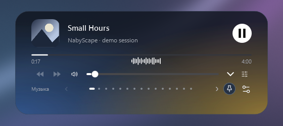
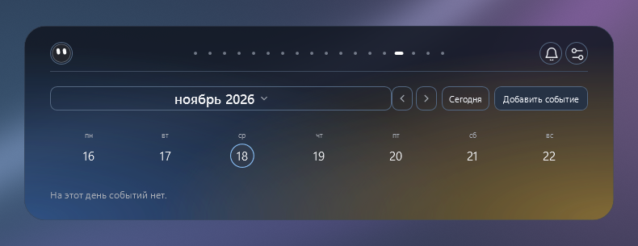
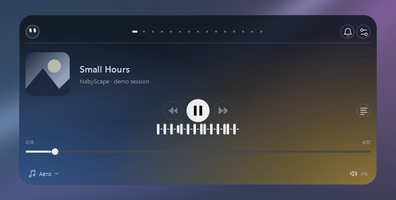
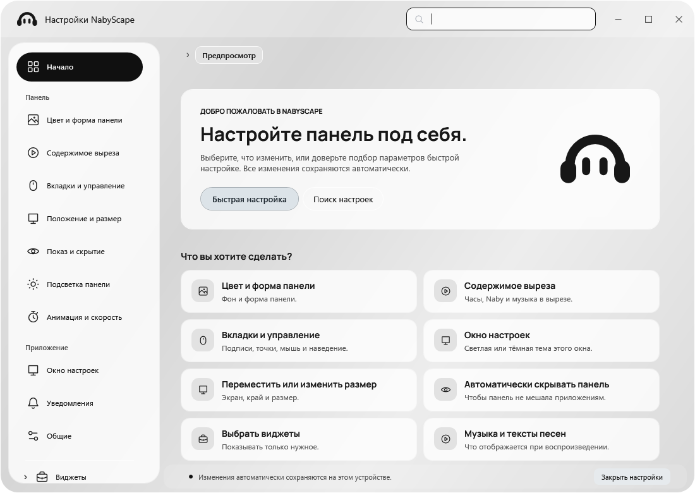
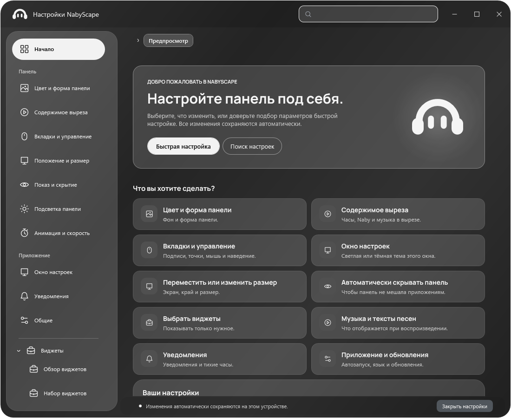

# NabyScape — русская версия

Панель для Windows с музыкой, текстами песен, заметками, задачами и таймерами. Русский интерфейс, светлая и тёмная темы, настройки под себя.

**Актуальный релиз нашего форка — 1.2.0.** Основан на [BillyNabil/nabyscape](https://github.com/BillyNabil/nabyscape), версия оригинала 2.26.1.

[**Скачать установщик для Windows x64**](https://github.com/MrBogomoll/nabyscape/releases/latest/download/NabyScape-win-x64-Setup.exe) · [Portable ZIP](https://github.com/MrBogomoll/nabyscape/releases/latest/download/NabyScape-win-x64-Portable.zip) · [Все файлы релиза](https://github.com/MrBogomoll/nabyscape/releases/latest)

## Сама панель

Так выглядит стеклянная панель NabyScape **1.2.0** в трёх размерах. Пока музыка выключена, вырез показывает дату и время. При воспроизведении в нём появляются обложка, название трека и громкость.

| | В простое | Во время музыки |
| --- | --- | --- |
| **Вырез** |  |  |
| **Мини-панель** |  |  |

**Развёрнутая панель в простое**. На вкладке календаря видна вся неделя. Сегодняшняя дата обведена контуром.



**Развёрнутая панель во время музыки**. Здесь доступны управление воспроизведением, звуковая волна и перемотка.



<details>
<summary>Посмотреть переход от выреза к мини-плееру</summary>


</details>

Снимки сделаны в приложении 1.2.0. Для показа прозрачности использован нейтральный фон. Трек *Small Hours*, обложка и звуковой сигнал демонстрационные. При подключённом Spotify в мини-плеере и развёрнутой панели появляется кнопка «Любимые». [Как подключить Spotify](docs/spotify.md).

## Два оформления

| Светлая тема | Тёмная тема |
| --- | --- |
|  |  |

Скруглённое окно, отдельная шапка для перетаскивания, поиск настроек и один общий сворачиваемый предпросмотр. Оформление настроек и цвета самой панели настраиваются отдельно. Музыка, погода, заметки и остальные функции собраны в разделе **«Виджеты»**.

## Что есть в приложении

- **Музыка:** управление воспроизведением, громкость, выбор медиасессии и визуализация звука.
- **Тексты песен:** синхронные строки на панели, автоматический поиск без прежнего ограничения на три языка, выбор источника и загрузка локального LRC. Транскрибирование сохранено.
- **Заметки:** общий черновик с необязательным заголовком и библиотека раскрывающихся карточек. Без заголовка названием становится первая фраза. Есть корзина на карточке и групповое удаление.
- **Задачи:** список дел с отметками выполнения. Добавление, удаление и отметки сохраняются локально; при ошибке записи изменения откатываются.
- **Таймеры, фокус и секундомер:** работа на панели и в отдельных окнах. В свёрнутом состоянии отображается работающий счётчик, а в простое — время.
- **Погода, буфер обмена, ярлыки и сведения о компьютере.** История буфера обмена включается отдельно.
- **ИИ Naby:** необязательный помощник с настройкой своего провайдера и голосовых функций. Ключи и модели не входят в релиз.
- **Показ и скрытие:** исключения для приложений, над которыми панель должна оставаться видимой; переключение вкладок колесом с настройкой кругового перехода.

Тексты песен зависят от доступности источников. Музыкальные функции требуют, чтобы проигрыватель передавал Windows сведения о воспроизведении.

## Установка

Релиз содержит сборку для **Windows 10/11 x64**. Среда .NET включена в приложение.

1. Скачайте `NabyScape-win-x64-Setup.exe` из [последнего релиза](https://github.com/MrBogomoll/nabyscape/releases/latest).
2. Если NabyScape уже работает, завершите его через значок в области уведомлений.
3. Запустите установщик. Для запуска без установки скачайте Portable ZIP, распакуйте его и откройте `NabyScape.exe`.

Для обновления с предыдущей версии или локальной беты установите релиз поверх имеющейся копии. Настройки, заметки и задачи хранятся в профиле Windows.

Portable означает запуск без установки: настройки всё равно хранятся в профиле Windows, а не рядом с EXE. Сборка не подписана цифровым сертификатом.

## Данные и обновления

Настройки, заметки и задачи хранятся в `%LOCALAPPDATA%\NabyScape`. Заметки и задачи — в файле `productivity.json`. Папку можно открыть из раздела **«Общие»**. Для резервной копии завершите приложение и скопируйте эту папку.

Автоматические обновления оригинального проекта отключены, чтобы они не заменили изменения форка. Новые версии устанавливаются вручную из [релизов этого репозитория](https://github.com/MrBogomoll/nabyscape/releases). Оригинальный установщик может заменить нашу копию, если запустить его вручную.

Автоматическое скрытие и исключения уже доступны. Дальнейшая доработка поведения панели при разделённом экране остаётся отдельной задачей.

## Сборка из исходников

Нужны Windows и .NET 10 SDK. В корне репозитория:

```powershell
./build.ps1 -OutputDirectory artifacts -Runtime win-x64
```

Скрипт собирает приложение, запускает проверки и создаёт EXE установщика. Проверки интерфейса запускаются отдельно с временным профилем:

```powershell
./artifacts/NabyScape.exe --diagnostics ./artifacts/ui-checks --isolated-diagnostics --settings-themes-only
```

В релизе опубликованы установщик, Portable ZIP, архив лицензий и файл `SHA256SUMS` для проверки целостности. Тег на странице релиза указывает на исходники соответствующей сборки.

## Обратная связь и лицензия

Ошибки и предложения можно оставить в [Issues](https://github.com/MrBogomoll/nabyscape/issues). Укажите версию, тему оформления и шаги, после которых возникает проблема.

Форк распространяется по [лицензии MIT](LICENSE). Исходный проект — [BillyNabil/nabyscape](https://github.com/BillyNabil/nabyscape). Уведомления автора и лицензии зависимостей сохранены в [licenses](licenses).
