# SentoBar

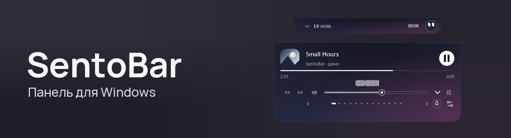

Стеклянная панель для Windows с музыкой, текстами песен, заметками, задачами и таймерами. Интерфейс на русском, светлая и тёмная темы. Из панели можно открыть чат с помощником Сенто.

SentoBar — форк NabyScape. Автор оригинального проекта — **BillyNabil**. [Оригинальный репозиторий](https://github.com/BillyNabil/nabyscape)

**В SentoBar 2.1.0** появились история чатов, диктовка, голосовой вызов «Сенто» и графики нагрузки для выбранных устройств. [Что изменилось](https://github.com/MrBogomoll/SentoBar/releases/tag/v2.1.0)

| Windows | Установщик | Без установки |
| --- | --- | --- |
| x64 | [Скачать EXE](https://github.com/MrBogomoll/SentoBar/releases/download/v2.1.0/SentoBar-win-x64-Setup.exe) | [Portable ZIP](https://github.com/MrBogomoll/SentoBar/releases/download/v2.1.0/SentoBar-win-x64-Portable.zip) |
| ARM64 | [Скачать EXE](https://github.com/MrBogomoll/SentoBar/releases/download/v2.1.0/SentoBar-win-arm64-Setup.exe) | [Portable ZIP](https://github.com/MrBogomoll/SentoBar/releases/download/v2.1.0/SentoBar-win-arm64-Portable.zip) |

## Сама панель

Стеклянная панель в трёх размерах. Пока музыка выключена, вырез показывает дату и время. Во время музыки в вырезе можно показывать название трека, текущую строку песни или звуковую волну.

| | В простое | Во время музыки |
| --- | --- | --- |
| **Вырез** | 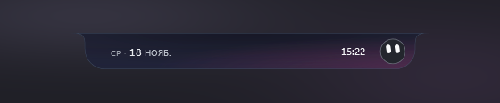 | 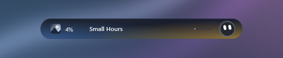 |
| **Мини-панель** | 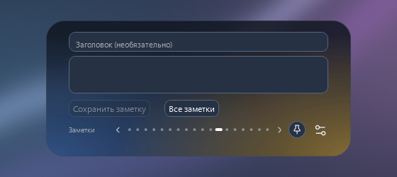 |  |

**Развёрнутая панель в простое**. На вкладке календаря видна вся неделя. Сегодняшняя дата обведена контуром.


**Текст песни**. В развёрнутом плеере текущая строка выделена среди соседних. В вырезе она помещается рядом с обложкой и громкостью.

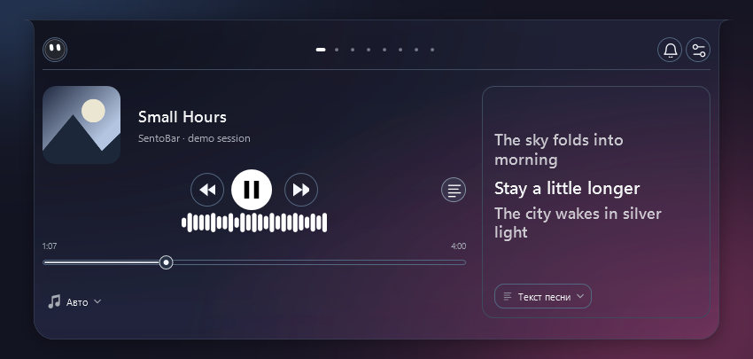

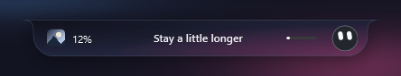

<details>
<summary>Посмотреть переход от выреза к мини-плееру</summary>

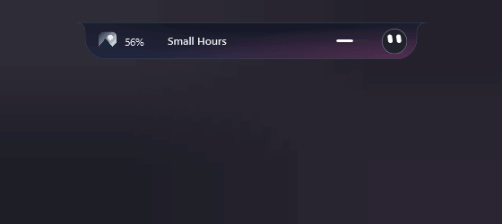

</details>

Трек *Small Hours*, текст, обложка и звуковая волна демонстрационные. При подключённом Spotify в мини-плеере и развёрнутой панели появляется кнопка «Любимые». [Как подключить Spotify](docs/spotify.md).

## Виджеты и оформление

Фон и градиент панели настраиваются отдельно от темы настроек. Для переключения вкладок доступны точки, иконки и подписи.

| Таймер · точки | Задачи · иконки |
| --- | --- |
| 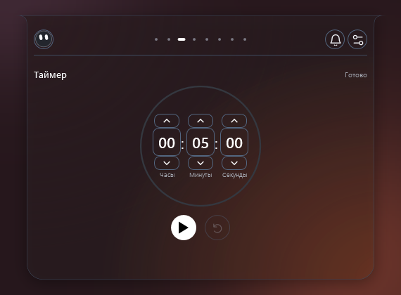 | 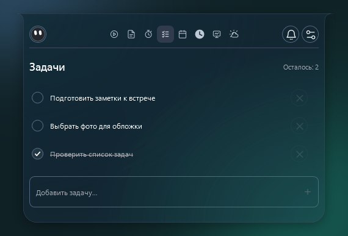 |

| Мини-панель погоды · подписи | Отдельное окно «Система» |
| --- | --- |
| 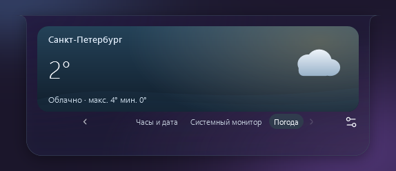 | 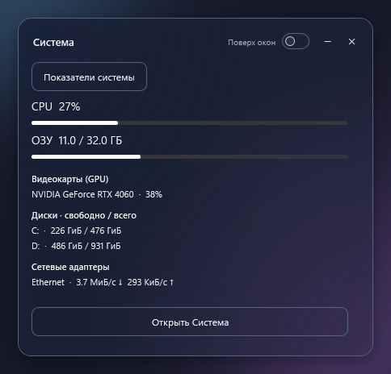 |

Откройте **«Виджеты → Часы и система → Показатели системы»**, чтобы выбрать, что показывать в развёрнутой панели, мини-панели и отдельном окне. Для видеокарт, дисков и сети можно выбрать конкретные устройства. Кнопка «Показатели системы» есть в развёрнутой панели и отдельном окне. [Как выглядит выбор устройств](docs/images/panel-system-settings.png).

На скриншотах использован демонстрационный профиль с примерами задач, прогноза и показателей компьютера.

## Светлая и тёмная темы настроек

| Светлая тема | Тёмная тема |
| --- | --- |
|  |  |

Скруглённое окно, отдельная шапка для перетаскивания, поиск настроек и один общий сворачиваемый предпросмотр. Оформление настроек и цвета самой панели настраиваются отдельно. Музыка, погода, заметки и остальные функции собраны в разделе **«Виджеты»**.

## Что есть в приложении

- **Музыка:** управление воспроизведением, громкость, выбор медиасессии и визуализация звука.
- **Тексты песен:** синхронные строки на панели, автоматический поиск без прежнего ограничения на три языка, выбор источника и загрузка локального LRC. Транскрибирование сохранено.
- **Заметки:** общий черновик с необязательным заголовком и библиотека раскрывающихся карточек. Без заголовка названием становится первая фраза. Есть корзина на карточке и групповое удаление.
- **Задачи:** список дел с отметками выполнения. Добавление, удаление и отметки сохраняются локально; при ошибке записи изменения откатываются.
- **Таймеры, фокус и секундомер:** работа на панели и в отдельных окнах. В свёрнутом состоянии отображается работающий счётчик, а в простое — время.
- **Погода, буфер обмена, ярлыки и сведения о компьютере.** История буфера обмена включается отдельно.
- **Помощник Сенто.** Для текстового чата можно войти через ChatGPT или указать своего провайдера. Голос настраивается отдельно. [Как подключить помощника](docs/assistant.md).
- **Показ и скрытие:** исключения для приложений, над которыми панель должна оставаться видимой; переключение вкладок колесом с настройкой кругового перехода.

Тексты песен зависят от доступности источников. Музыкальные функции требуют, чтобы проигрыватель передавал Windows сведения о воспроизведении.

## Установка

Поддерживаются Windows 10 версии 2004 и новее и Windows 11. Среда .NET входит в комплект.

1. Выберите установщик для архитектуры своего ПК. [Файлы релиза и контрольные суммы](https://github.com/MrBogomoll/SentoBar/releases/tag/v2.1.0)
2. Если панель уже запущена, завершите её через значок в области уведомлений.
3. Запустите установщик и откройте SentoBar через меню «Пуск». Для запуска без установки распакуйте Portable ZIP и откройте `SentoBar.exe`.

Portable-сборка хранит данные в профиле Windows. Установщики и исполняемые файлы поставляются без цифровой подписи.

## Данные и обновления

SentoBar хранит настройки, заметки и задачи в `%LOCALAPPDATA%\SentoBar`. При переходе с прежней русской сборки её профиль из `%LOCALAPPDATA%\NabyScape` копируется в новый, а исходный остаётся резервной копией. Заметки и задачи — в файле `productivity.json`. Папку можно открыть из раздела **«Общие»**. Для резервной копии завершите приложение и скопируйте эту папку.

Автоматические обновления оригинального проекта отключены, чтобы они не заменили изменения форка. Новые версии устанавливаются вручную из [релизов этого репозитория](https://github.com/MrBogomoll/SentoBar/releases).

Автоматическое скрытие и исключения уже доступны. Дальнейшая доработка поведения панели при разделённом экране остаётся отдельной задачей.

## Сборка из исходников

Нужны Windows и .NET 10 SDK. В корне репозитория:

```powershell
./build.ps1 -OutputDirectory artifacts -Runtime win-x64
```

Скрипт собирает приложение, запускает проверки и создаёт EXE установщика. Проверки интерфейса запускаются отдельно с временным профилем:

```powershell
./artifacts/SentoBar.exe --diagnostics ./artifacts/ui-checks --isolated-diagnostics --settings-themes-only
```

В релизе опубликованы установщик, Portable ZIP, архив лицензий и файл `SHA256SUMS` для проверки целостности. Тег на странице релиза указывает на исходники соответствующей сборки.

## Обратная связь и лицензия

Ошибки и предложения можно оставить в [Issues](https://github.com/MrBogomoll/SentoBar/issues). Укажите версию, тему оформления и шаги, после которых возникает проблема.

Форк распространяется по [лицензии MIT](LICENSE). Исходный проект — [BillyNabil/nabyscape](https://github.com/BillyNabil/nabyscape). Уведомления автора и лицензии зависимостей сохранены в [licenses](licenses).
